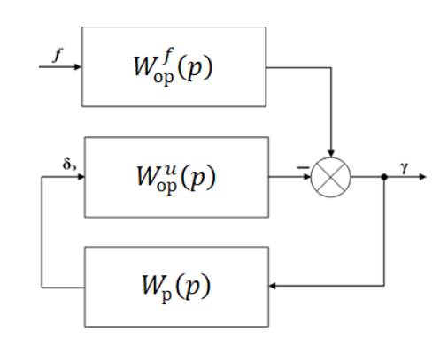
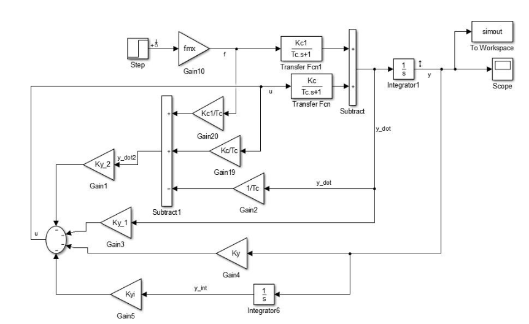
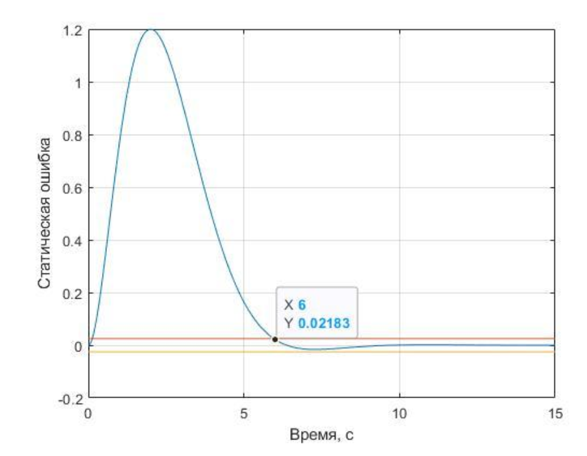
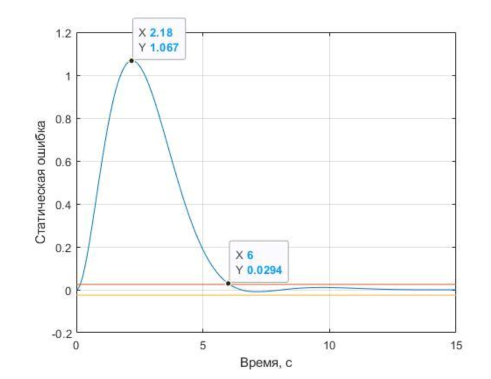
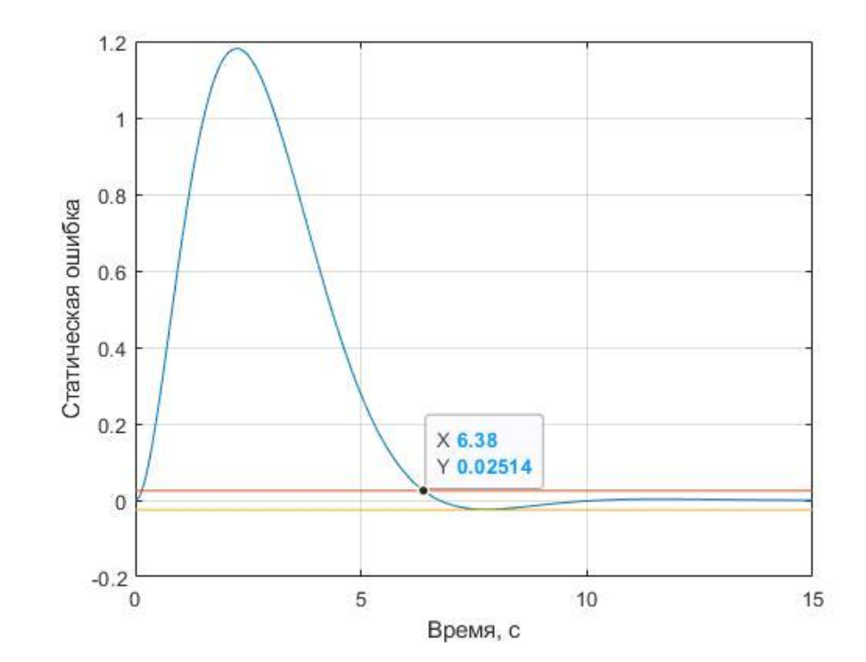
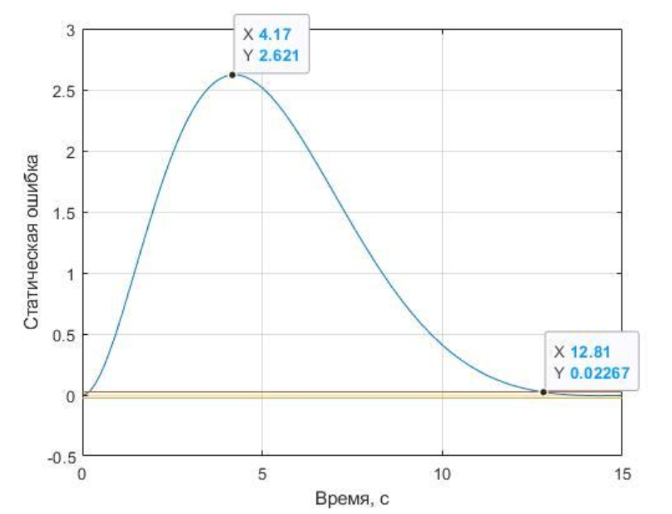

# Синтез астатического регулятора крена ЛА

Данный репозиторий содержит материалы по синтезу и математическому моделированию регулятора динамической системы (на примере астатической системы стабилизации крена летательного аппарата) по желаемым свойствам переходного процесса.

---

## Теоретическая часть

**Управление** — это процесс на входе объекта, обеспечивающий протекание процессов на выходе таким образом, чтобы достигалась поставленная цель. При наличии внешних возмущений ($f$) возникает помеха, для парирования которой используется **регулятор** (закон регулирования).

В данной работе рассматривается задача структурного и параметрического синтеза регулятора, когда объект управления известен, а желаемые показатели переходного процесса (время регулирования $t_{рег}$, перерегулирование $\sigma$, статическая ошибка и максимальное отклонение $\gamma_{max}$) заданы.

### Астатическая система
Для астатической системы характерно отсутствие статической ошибки при постоянном возмущении. В частотной области это накладывает условие на передаточную функцию (ПФ) замкнутой системы $K_0(p)$:
$$ \lim_{p \to 0} K_0(p) = 0 $$
Для выполнения этого требования и обеспечения простоты, полином числителя желаемой ПФ должен содержать множитель $p$, а знаменатель должен иметь степень не ниже третьей (чтобы разность степеней знаменателя и числителя равнялась двум, как у объекта по возмущению).

*Рисунок 1: Обобщенная структурная схема системы стабилизации крена ЛА*

---

## Ход работы

1. **Анализ исходных данных**: Определение параметров ЛА и требований к переходному процессу (Вариант 16).
2. **Формирование желаемой ПФ**: Задание эталонной динамики системы третьего порядка.
3. **Аналитический синтез**: Вывод дифференциального уравнения регулятора (интегральный закон) и расчет его передаточных отношений.
4. **Техническое упрощение**: Рассмотрение вариантов отказа от части измерителей (датчиков) для упрощения аппаратной части:
   - Система с полным набором измерителей.
   - Упрощенная система (без углового акселерометра).
   - Система минимальной сложности (без акселерометра и датчика угловой скорости).
5. **Моделирование**: Сборка схемы в `Matlab-Simulink` и верификация переходных процессов.

---

## Математическая модель и Формулы

### 1. Исходные данные
| Параметр | Обозначение | Значение |
|---|---|---|
| Постоянная времени ЛА | $T_c$ | $1.0$ с |
| Коэф. передачи по управлению | $k_c$ | $0.5$ |
| Коэф. передачи по возмущению | $k_{c1}$ | $4.0$ |
| Максимальное возмущение | $f_{mx}$ | $0.6$ |
| Допустимое отклонение крена | $\gamma_{max}$ | $1.2^\circ$ |
| Время регулирования | $t_{рег}$ | $6.0$ с |
| Перерегулирование | $\sigma$ | $5\%$ |

### 2. Передаточные функции объекта
Для короткопериодического движения крена ПФ объекта по управлению ($\delta_э$) и возмущению ($f$) имеют вид:
$$ W_{op}^U(p) = \frac{k_c}{T_c p + 1}, \quad W_{op}^f(p) = \frac{k_{c1}}{T_c p + 1} $$
Дифференциальное уравнение объекта:
$$ T_c \dot{\gamma} + \gamma = k_c \delta_э + k_{c1} f \quad \text{(Формула 2.8)} $$

### 3. Желаемая передаточная функция
Зададимся желаемой ПФ замкнутой системы $K_0(p)$ третьего порядка:
$$ K_0(p) = \frac{k_p p}{p^3 + k_1 \Omega p^2 + k_2 \Omega^2 p + \Omega^3} $$
где $k_1 = k_2 = 2.3$ (коэффициенты стандартного оптимального распределения корней), $\Omega$ — средняя собственная частота, $k_p$ — коэффициент передачи.

### 4. Интегральный закон регулирования
На основе желаемой ПФ и уравнения объекта выводится закон управления, требующий измерения угла, скорости, ускорения и интеграла ошибки:
$$ \delta_э(t) = k_\gamma \gamma + k_{\dot{\gamma}} \dot{\gamma} + k_{\ddot{\gamma}} \ddot{\gamma} + k_{\int} \int \gamma \, dt \quad \text{(Формула 2.4)} $$

Для формирования сигнала второй производной $\ddot{\gamma}$ (если акселерометр отсутствует) используется аналитическая связь из уравнения объекта (2.8).

---

## Расчет и Результаты Моделирования

Моделирование проводилось в среде **Matlab-Simulink**. Схема моделирования включает блоки формирования производных, передаточные функции и интегратор.

*Рисунок 2: Схема моделирования системы стабилизации крена в Simulink*

### Вариант 1: Полный набор измерителей
Используются датчики угла, угловой скорости и углового ускорения.
* **Расчетные параметры**: $k_p = 4.5$, $\Omega = 0.89$ с$^{-1}$.
* **Результат**: $t_{рег} = 6$ с, $\gamma_{max} = 1.2^\circ$.
* **Вывод**: Система полностью удовлетворяет жестким требованиям ТЗ.

*Рисунок 3: График переходной характеристики системы с полным набором измерителей*

### Вариант 2: Упрощенная система (Отказ от углового акселерометра)
Угловой акселерометр подвержен шумам вибрации. Отказ от него ($\ddot{\gamma} = 0$) требует пересмотра требований.
1. **Отказ от требования к амплитуде ($\gamma_{max}$)**:
   * $t_{рег} = 6$ с, $\gamma_{max} = 1.067^\circ$ (отклонение < 15%).
   * *Вывод*: Упрощение обосновано.
   
   *Рисунок 4*

2. **Отказ от требования к времени регулирования ($t_{рег}$)**:
   * $t_{рег} = 6.38$ с (рост на 6%), $\gamma_{max} = 1.2^\circ$.
   * *Вывод*: Упрощение обосновано.
   
   *Рисунок 5*

### Вариант 3: Система минимальной сложности
Отказ от углового акселерометра И датчика угловой скорости (ДУС). Используются только интегратор и датчик угла.
* **Результат**: $t_{рег} = 12.81$ с (рост в 2 раза!), $\gamma_{max} = 2.6^\circ$ (превышение на 120%).
* **Вывод**: Упрощение **не обосновано**, система не справляется с возмущениями в рамках заданных допусков.

*Рисунок 6: График переходной характеристики системы минимальной сложности*
